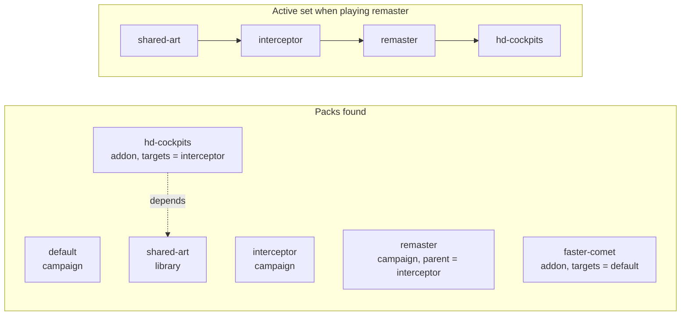

# Packs

A **pack** is a folder of content with a `pack.ini` manifest. The engine loads the built-in
packs (the `packs/` folder next to the program, or `--packs <dir>`), then every mod in the user
mods folder (or `--mods <dir>`). Within a folder, packs are found in folder-name order and then
**ordered so that every pack comes after the packs it depends on** (otherwise keeping that
order). Later packs override earlier ones, key by key.

Since Stage 2 not every pack found is loaded: the player plays **one campaign**, and only the
packs that belong with it load — see [Mod kinds and the active set](#mod-kinds-and-the-active-set).

Default mods folder: macOS `~/Library/Application Support/OpenInterceptor/mods/`, Linux
`$XDG_DATA_HOME/openinterceptor/mods/` (default `~/.local/share/openinterceptor/mods/`), or
`settings.ini` `[paths] mods` ([Settings](../architecture/settings.md)).

## Mod kinds and the active set

Every pack is one of three **kinds** (`kind =` in `pack.ini`; from `src/content/pack.rs`):

| Kind | What it is | Extra keys |
|---|---|---|
| `campaign` | A complete, playable game (`default`, `interceptor`). | `parent` — the campaign it extends. |
| `addon` (the default) | Changes to one or more campaigns: a balance mod, a new ship, an HD cockpit. | `targets` — the campaign ids it applies to (`*` = all; empty = all, as Stage 1 packs). |
| `library` | Shared content, loaded only when another pack `depends` on it. | — |

When campaign *C* is played, the **active set** is:

1. *C*'s **parent chain** — its `parent`, that campaign's parent, and so on (root first);
2. every **addon** whose `targets` names a campaign in the chain (or `*`, or nothing);
3. every pack any of those `depends` on (libraries and others), transitively.

Everything else stays out. The active set then loads parents and dependencies first; later
packs override earlier ones key by key, so a campaign with `parent = interceptor` is "the
Interceptor campaign plus my changes".



### Choosing the campaign

| Where | How |
|---|---|
| Launcher | The header shows *Campaign: …*; **Tab** (pad **Y**) switches to the next campaign and reloads content. |
| `settings.ini` | `[game] campaign = default` — the launcher writes the last choice here. |
| Command line | `--campaign <id>`. |
| None of these | `interceptor` when the player's data makes it available, otherwise `default`, otherwise the first campaign found. |

An unknown or unavailable campaign falls back to that default with a warning. `--list` lists
the campaigns (`*` marks the loaded one); `--check` checks **every campaign separately**, each
with its own active set, so an addon must pass with each campaign it targets. If no pack is a
campaign at all (a Stage 1 set-up), every pack loads as before.

### Mod-format version

`format = 1` records the mod-format version the pack was written for. A pack with a higher
`format` than the engine reads (`pack::FORMAT`, currently 1) is refused with a message asking
for a newer OpenInterceptor; a missing `format` means the current one.

## Switching packs on and off

A pack in the active set loads unless its id is listed in `settings.ini`:

```ini
[packs]
disabled = hd-cockpit-test, balance-tweak
```

A disabled pack contributes nothing — no rules, no scenarios, no asset overrides — so removing
an id from the list restores the mod, and adding it restores the originals. Packs that depend
on a disabled pack are skipped too. (XWVM offers the same whole-pack switch in its launcher's
*Game Content* screen; a launcher screen for this is planned for Stage 5.)

## Layout

```text
my-campaign/
  pack.ini              the manifest (required)
  rules/*.ini           ships, beams, missiles, objects, factions, cockpits, systems,
                        [flight], [power], [damage], [sounds]
                        (all files loaded, in file-name order)
  scenarios/*.ini       playable arenas (all files loaded)
  models/*.obj, *.mtl   models (any folder works; paths are written in the rules)
  textures/*.png, *.tga textures; also how a pack re-skins a model texture by name
  images/<dll>/<id>.png replacement original images (cockpits, HUD art) — see Overrides
  sounds/*.wav          sounds; sounds/<name>.wav also replaces an original sound
```

Only `pack.ini` is required; every folder is optional.

## `pack.ini`

```ini
[pack]
id = my-campaign            ; letters, digits, - and _ only; must be unique
name = My Campaign
version = 1.0
description = A new war on the frontier
kind = campaign             ; campaign | addon (the default) | library
parent = default            ; campaigns only: the campaign this one extends
targets =                   ; addons only: campaigns it applies to (* = all)
depends =                   ; comma-separated ids that must load first
requires_original = no      ; yes = needs the player's Interceptor data (--data)
format = 1                  ; mod-format version it was written for
```

| Key | Default | Meaning |
|---|---|---|
| `id` | — (required) | Unique id. |
| `name` | the id | Shown on the launcher. |
| `version` | `0` | Free text. |
| `description` | empty | Free text. |
| `kind` | `addon` | `campaign`, `addon` or `library` (above). Anything else is an error. |
| `parent` | none | Campaigns only (an error on other kinds): the campaign this one extends. A missing parent or a parent cycle is an error. |
| `targets` | all | Addons only: comma-separated campaign ids, or `*`. |
| `format` | current | Mod-format version; newer than the engine's is an error. |
| `depends` | none | Packs that must be installed and load first. A missing dependency is an error; a cycle is an error. |
| `requires_original` | `no` | `yes` skips the pack (with a warning) when no original data is loaded; packs depending on it are skipped too. |

## Built-in packs

| Pack | Needs original data | Contents |
|---|---|---|
| `default` | no | Campaign **Perils of the Void**: the original-free default campaign — 1950s film-serial rocket ships of the Interplanetary Guard against the flying saucers of the Umbral Dominion. Seven factions, six beams and two missiles, playable rockets `comet`, `meteor`, `thunderbolt` flown from the 3D cockpit `guard`, saucers, a robot sentinel, freighters, stations, systems and power rules, and the scenarios `rocket-vs-saucer`, `dominion-raid`, `black-comet-ambush`, `systems-trial`. Models, textures and sounds are generated by `tools/default_assets/`. **Copy this to start a mod** — see [Make your first mod](first-mod.md). |
| `interceptor` | yes | Campaign. Rules that inherit the original `GameSettings.ini` sections, the class → mesh mapping, cockpits, systems and power rules (`rules/systems.ini`), event sounds, and the test scenarios `flight-test`, `combat-test`, `gunnery-range`, `station-tour`, `systems-trial`. **No assets**: every model, texture, image and sound is an `original:` reference into the player's CD. |

## Asset references

Rules refer to assets with a reference string:

| Written as | Means |
|---|---|
| `models/scout.obj` | A file in the pack that wrote the reference. `\` is accepted; `.` and `..` are normalised **inside the pack** (`models/../textures/a.png` = `textures/a.png`); a path that would leave the pack, starts with `/` or contains `:` is refused. |
| `original:INTTYPEA` | A named resource in the original DLLs; the kind comes from the key (`Model` → an `XMSH` mesh). |
| `original:CockpitA.dll#12000` | Resource 12000 of a specific original DLL (cockpit `Image`). |
| `original:GameSettings.ini`, `original:target lock.wav` | An original file, found by name anywhere in the data folder (any case). |

Textures named inside a model are looked up as `textures/<name>.png` then `.tga` in every pack,
latest pack first, before falling back to the original `XTXR` texture of that name. Dropping
`textures/cubetop.png` into a mod therefore re-skins every original model that uses `cubetop`.
The same rule covers every original asset — meshes, cockpit and HUD images, sounds — see
[Overrides and extraction](overrides.md).
