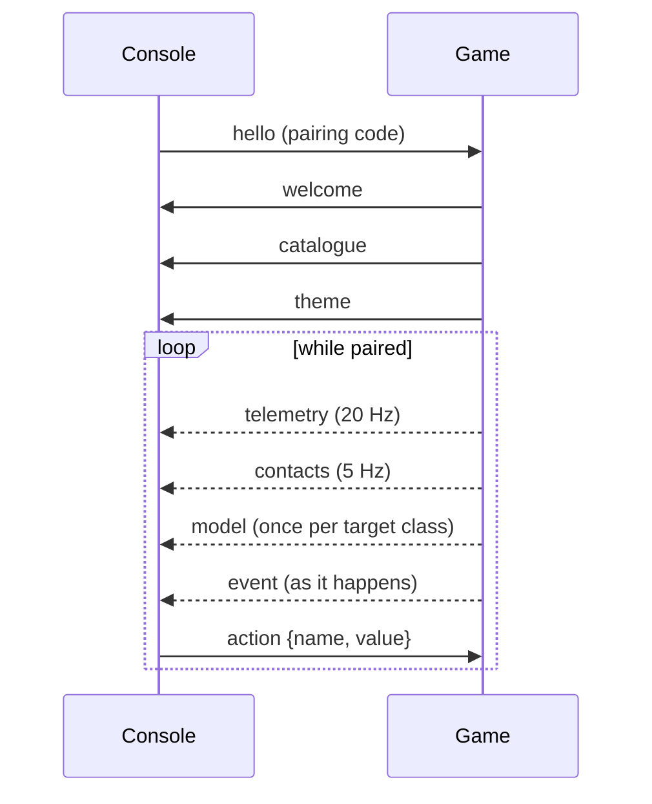

# Console protocol

**Status: planned.** The messages the game and a control console exchange. The console is the
tablet page served by the game ([F-CON-004](../definition/control-console.md#f-con-004-tablet-control-console));
later, a physical panel over USB serial ([F-CON-007](../definition/control-console.md#f-con-007-physical-control-panel)).
Requirements: [R-CON-009 – R-CON-021](requirements/control-console.md).

The message names, their direction and their rates below are decided. Field lists are a first
draft, marked *planned*: implementation (interlude items C1–C4) fixes them, and this page is
updated in the same change.

## Transport

- Each message is one JSON object with a `type` field.
- **WebSocket** (first transport): the game serves the console page and the socket over HTTP on
  the local network only, port **8765** by default and changeable in the settings. The console is
  **off by default** (decision D2).
- **USB serial** (later, for an Arduino panel): the same messages, one per line. The protocol
  never depends on the transport.

## Session



## Messages

| Message | Direction | When | Carries (*planned* fields) |
|---|---|---|---|
| `hello` | console → game | On connect | The pairing code shown by the game; a client name and protocol version. |
| `welcome` | game → console | Code accepted | Protocol version, the active campaign. A wrong code closes the connection. |
| `catalogue` | game → console | After `welcome`; again whenever the craft changes | The action catalogue (R-CON-007): each action's id, name, group, description and value kind, and **its availability for the current craft** (a feature the craft lacks, such as cloak or ECM not fitted or no missiles, is marked not fitted). Every function group is always listed (R-CON-019). |
| `theme` | game → console | After `welcome`; again when the campaign or craft changes | The active pack's console theme (R-CON-020): colours, fonts, frames and images taken from the pack's own console assets — never original art (R-CON-021). |
| `telemetry` | game → console | **20 Hz** | The player craft's state: speed with drift components, throttle, energy, shields fore and aft, hull, power settings, system conditions, weapons and missiles, lock, current target. |
| `contacts` | game → console | **5 Hz** | Radar contacts with position relative to the player, faction and kind; nav points. |
| `model` | game → console | Once per target class, when first targeted | The target's mesh, **decimated**, for the viewport (R-CON-015). The orientation itself travels in `telemetry`. |
| `action` | console → game | On a tap or slider move | `{name, value}`: a catalogue action and its value (a press, or a level for sliders). Unknown or unavailable actions are ignored (R-CON-011). |
| `event` | game → console | As it happens | Messages and events (system damaged, missile lock, shield down, mission result). |

```json
{"type": "action", "name": "power_shields_up", "value": 1}
```

*The action name in the example is illustrative; names come from the catalogue.*

## Open

- Field names and units of every message; the protocol version scheme.
- The pairing code's length and lifetime, and how the game shows it.
- The decimation budget for `model`, and whether textures are sent.
- Line framing and the message subset for the serial transport.
- The theme's file format in a pack.

## Revision history

| Version | Date | Change |
|---|---|---|
| 1.0.0 | 2026-11-11 | Bootstrap (planned): transport, session, messages `hello`, `welcome`, `catalogue` (with per-action availability), `theme`, `telemetry`, `contacts`, `model`, `action`, `event` |
