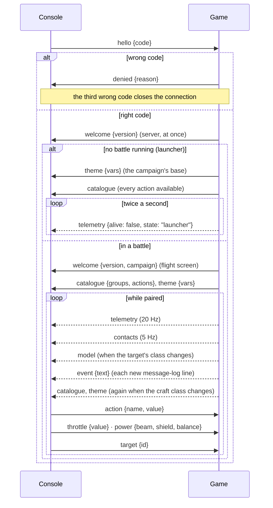

# Console protocol

**Status: version 1 implemented** (C1, app 0.4.0; `power` with C2 in 0.4.11; `model` with C3 in
0.4.14; `contacts`, `event` and `target` with C4 in 0.4.15; `theme` with C2b in 0.5.0). Only the
serial transport (C5) is still planned. The messages the game and a
control console exchange. The console is the tablet page served by the game
([F-CON-004](../definition/control-console.md#f-con-004-tablet-control-console)); later, a
physical panel over USB serial ([F-CON-007](../definition/control-console.md#f-con-007-physical-control-panel)).
Requirements: [R-CON-009 – R-CON-021](requirements/control-console.md). How it is built:
[Remote console](../implementation/architecture/remote.md).

Protocol **version 1** below is as built (`src/remote/protocol.rs`): from the console `hello`,
`action`, `throttle`, `power`, `target` and `ping`; from the game `welcome`, `denied`,
`catalogue`, `telemetry`, `theme`, `model`, `contacts` and `event`. The additions since C1 kept
the version at 1: each is a new message type, and a page that does not know a type ignores it.

## Transport

- Each message is one JSON object with a `type` field, sent as one WebSocket text frame.
- **WebSocket** (first transport, built): the game serves the console page (`/`,
  `/console.js`, `/console.css` and `/keepawake.mp4`, built into the program; files honour
  HTTP `Range` requests with `206 Partial Content` since app 0.4.8) and the socket (a WebSocket upgrade
  on any path; the page uses `/ws`) over HTTP/1.1 on port **8765** by default
  (`console.port` in `settings.yaml`, `--console-port`). The console is **off by default**
  (decision D2): `--console` or `console.enabled` turns it on.
- **Local network only**: connections from addresses that are not private, link-local,
  unique-local or loopback are dropped without an answer.
- **Pairing from the address** (app 0.4.7): `/?code=123456` pairs straight away with that
  code, for a future QR code shown by the game.
- **USB serial** (later, for an Arduino panel): the same messages, one per line. The protocol
  never depends on the transport.

## Session



Since app 0.4.7 (main `c42d773`) the **server answers a right code itself**: its connection
thread sends `welcome {version}` at once, so the page knows it is paired on any screen. Before,
only the flight screen answered, and a tablet paired from the launcher waited for ever. During a
battle the flight screen also sends `welcome {version, campaign}`. The page switches from the
pairing screen to the console on `welcome` (not on `catalogue`).

Until a console has paired, every message other than `hello` is ignored, as is any message
that does not decode. When the connection closes, everything that console was holding is
released.

## Messages (version 1, as built)

### Console → game

| Message | Fields | Meaning |
|---|---|---|
| `hello` | `code`: string | The 6-digit pairing code the game shows. A right code pairs; a wrong one gets `denied`, and the third wrong code on a connection closes it. |
| `action` | `name`: string, `value`: number (default 1) | A catalogue action. For a `hold` action, `value` 1 presses and 0 releases it; for a `tap` action, a value above 0.5 fires it once. An unknown name is ignored. An action the craft cannot perform reaches the game like the bound key would, and does nothing. |
| `throttle` | `value`: number | The throttle position, clamped to 0 – 1, as if set from a slider. |
| `power` | `beam`, `shield`: number (optional), `balance`: string (optional) | Set from the Cockpit layout's sliders (app 0.4.11): the beam and shield charge levels outright (0 = A, clamped to 0 – 15), within the power budget (the game lowers the other setting if the budget needs it), and the shield balance `"equal"`, `"forward"` or `"aft"`. Any field may be left out. An unknown balance is refused. |
| `target` | `id`: string | Target this contact (app 0.4.15): the `id` from a `contacts` entry, `"slot:generation"`. The game targets it only if it is still on the player's radar; otherwise nothing happens. A malformed id is refused. |
| `ping` | none | Heartbeat, every 250 ms. A console silent for 1 s (`HOLD_TIMEOUT`) has its held actions released, so a dropped connection never leaves a button pressed. |

```json
{"type": "hello", "code": "123456"}
{"type": "action", "name": "fire_beams", "value": 1}
{"type": "action", "name": "fire_beams", "value": 0}
{"type": "throttle", "value": 0.8}
{"type": "power", "beam": 3, "balance": "aft"}
{"type": "target", "id": "3:0"}
```

### Game → console

| Message | When | Fields |
|---|---|---|
| `welcome` | Right code: from the server at once with `version` only; during a battle the flight screen sends it again with `campaign` | `version` (1), `campaign` (the active campaign's id, empty if none; flight screen only). |
| `denied` | Wrong code | `reason` (`"wrong pairing code"`). |
| `catalogue` | After `welcome`; again whenever the player's craft class changes. Outside a battle (the launcher) a catalogue with **every action marked available**, since there is no craft yet; the battle sends the real one when it starts | `groups`: `[{id, title}]` in menu order (`flight`, `throttle`, `weapons`, `targeting`, `power`, `wingmen`, `views`, `camera`, `interface`). `actions`: `[{name, group, label, kind, available}]` for **every** action of the catalogue (R-CON-007): `name` as in `bindings.yaml`, `group` one of the ids above, `label` the display name, `kind` `"hold"` or `"tap"`, `available` false when the craft has no equipment for it (R-CON-019). |
| `telemetry` | **20 Hz** while paired in a battle; **twice a second** outside one | See below. Outside a battle: `{alive: false, state}` only, with `state` the screen (`"launcher"`). |
| `theme` | On pairing (the campaign's base theme, from the launcher); in a battle with each `catalogue` (the base with the craft's cockpit layered on) | `vars`: an object of CSS custom properties: `--bg`, `--panel`, `--line`, `--ink`, `--dim`, `--hot`, `--warn`, `--danger`, `--off` as `#rrggbb`; `--font` (a CSS font list); `--corner` (e.g. `"2px"`). Only what the theme sets is sent; `vars: {}` means the page's own look. See [Theme](#theme). |
| `model` | When the target's class changes, and again when a tablet pairs | `name` (class name), `groups: [{color, positions, indices}]`. See [Model](#model). |
| `contacts` | **5 Hz** while paired in a battle | `range` (the radar range, metres), `list: [{id, name, relation, station, target, pos, vel}]`. See [Contacts](#contacts). |
| `event` | Each new line of the pilot's message log | `text`: the line as the message line shows it. |

**Availability.** An action is unavailable when the current craft lacks what it needs: `cloak`,
`ecm` and `tractor` need that system fitted; the four VCT slides need a class with `vct`;
missile firing and cycling need missiles aboard; beam firing, link cycling, beam charge and
power-to-beams need a class with beams. Every other action is always available. Unavailable
actions are still listed, so the console shows them disabled, never hidden.

**`telemetry` fields.** Fractions are 0 – 1; distances in metres, speeds in m/s.

| Field | Type | Meaning |
|---|---|---|
| `time` | number | Mission time, seconds. |
| `alive` | bool | False once the player's craft is gone, or when no battle is running; then no other field is sent except `state`. |
| `hits`, `hull_hits` | number | Running counts, since the battle began, of weapon hits on the player's craft and of those that struck the hull (app 0.4.9). The page plays a brief static effect when either rises: lighter for a shield hit, stronger for a hull hit ([R-CON-024](requirements/control-console.md#r-con-024-hit-static)). |
| `state` | string | Only when no battle is running: the screen the game is on (`"launcher"`). The page shows *Not flying (launcher)*; `alive: false` without `state` is shown as *DESTROYED*. |
| `craft` | string | The craft class's name. |
| `velocity` | `[x, y, z]` | Velocity in the craft's body axes: x right, y up, **z forward** (so `z` is forward speed and `x`, `y` are the drift). |
| `throttle` | number | Throttle position, 0 – 1. |
| `hull`, `energy` | number | Fractions of the class's maximum. |
| `shields` | `[fore, aft]` | Shield fractions. |
| `power` | `[beam, shield, levels, used, budget]` | The power distribution, as on the HUD's power readout. |
| `link` | string | The beam link mode, lower case. |
| `afterburner`, `braking` | bool | Afterburner lit; brake held. |
| `missile` | `{name, count}` | The selected missile rack; absent when the craft carries none. |
| `systems` | `[{kind, health, destroyed, on}]` | Each fitted system: its kind (lower case), health fraction, destroyed, switched on. |
| `target` | object | Absent without a target. `name` (class name), `relation` (`friendly`, `hostile`, `neutral`), `protect` (the target is protected by the player's faction), `distance`, `closing` (closing speed, positive while the gap shrinks), `hull`, `shields [fore, aft]`, and `rotation [x, y, z, w]`: the target's orientation **in the player's body axes** (the conjugate of the player's rotation times the target's), for the target viewport (R-CON-015). |

```json
{"type": "telemetry", "time": 12.5, "alive": true, "craft": "…", "velocity": [20, 0, 100],
 "throttle": 0.6, "hull": 1, "energy": 0.8, "shields": [1, 0.7], "power": [2, 2, 4, 4, 6],
 "link": "…", "afterburner": false, "braking": false, "missile": {"name": "…", "count": 4},
 "systems": [{"kind": "cloak", "health": 1, "destroyed": false, "on": false}],
 "target": {"name": "…", "relation": "hostile", "protect": false, "distance": 1000,
            "closing": 35, "hull": 0.5, "shields": [0, 1], "rotation": [0, 0.707, 0, 0.707]}}
```

*Values in the examples are illustrative.*

### Theme

Built by `protocol::theme` from a `rules::ThemeLayer` (R-CON-020): the campaign's
`console.theme`, with `console.cockpits.<id>` layered on by `ConsoleTheme::for_cockpit` while
flying a craft with that cockpit. Colours are written as `#rrggbb` from the rules' RGB 0 – 1.
The page sets each variable on the document root and removes variables a later theme leaves
out, so they fall back to `console.css`. The keys a pack writes are on
[Console themes](../modding/console-themes.md).

```json
{"type": "theme", "vars": {"--bg": "#0d0a14", "--line": "#c9a34a", "--hot": "#ffcf59",
 "--font": "Futura, 'Avenir Next', sans-serif", "--corner": "2px"}}
```

### Model

For the target viewport (R-CON-015), built by `protocol::model`:

- the **most detailed level of detail with at most 3000 triangles**
  (`protocol::MODEL_TRIANGLE_BUDGET`), or the coarsest if every level is larger;
- **normalised to radius 1** (positions divided by the model's radius, rounded to 3 decimals);
- one entry per **material group**: `positions` (flat `[x, y, z, …]`, only the vertices that
  group uses, renumbered from 0), `indices` (triangles, three per face) and `color` (RGB 0 – 1):
  a textured group's colour is its texture's average (`protocol::average_color`, transparent
  pixels ignored), an untextured group's is its vertex colour. **No textures are sent.**

Axes are the model's own (x right, y up, −z ahead, as in the engine); the page turns it by
`telemetry.target.rotation`. The flight screen builds each class's message once and caches it.
A model that fails to load gives `{type: "model", name}` with no groups.

```json
{"type": "model", "name": "…", "groups": [{"color": [0.6, 0.75, 0.6],
 "positions": [0, 0, -1, -0.5, 0, 0.5, 0.5, 0, 0.5], "indices": [0, 2, 1]}]}
```

### Contacts

For the map (R-CON-014, R-CON-016), built by `protocol::contacts`: every live craft on the
player's radar (`sim::systems::on_radar`), the player excluded.

| Field | Type | Meaning |
|---|---|---|
| `id` | string | `"slot:generation"` of the ship handle; send it back in `target`. A reused slot gets a new generation, so a stale id never targets a newcomer. |
| `name` | string | The class name. |
| `relation` | string | `friendly`, `hostile`, `neutral`, or `objective` (a craft the player's faction protects). |
| `station` | bool | A static object (station, base, module). |
| `target` | bool | The player's current target. |
| `pos` | `[x, y, z]` | Position relative to the player, metres, **in the player's own axes**: x right, y up, **z ahead**. |
| `vel` | `[x, y, z]` | Velocity relative to the player, m/s, in the same axes. |

`range` at the top level is the radar range (`flight.radar_range`), which the map's rings use.
Because positions are already in the player's axes, the page needs no orientation to draw the
map around the player.

```json
{"type": "contacts", "range": 6000, "list": [
 {"id": "3:0", "name": "…", "relation": "hostile", "station": false, "target": true,
  "pos": [-400, 300, 2100], "vel": [40, 0, -90]}]}
{"type": "event", "text": "…"}
```

## Keeping the tablet awake

Not a message: the page itself keeps the tablet's screen on while it is open (app 0.4.8, main
`f1c8be8`, [R-CON-022](requirements/control-console.md#r-con-022-keep-the-tablet-awake)).

1. The **Screen Wake Lock API** (`navigator.wakeLock.request("screen")`) where the browser
   allows it. Safari allows it only on secure (https) pages, so it does not apply to an iPad on
   the plain-http console.
2. Otherwise a **tiny black clip**, `/keepawake.mp4` (2 KB, generated by
   `tools/console_assets/make_keepawake.swift` with AVFoundation; the project's own output),
   played muted, inline and looping, out of sight: browsers do not let the screen sleep while a
   video plays. iOS Safari plays video only from a server that honours `Range` requests, hence
   `206 Partial Content`.

It starts on the pairing tap, again on any tap until it runs (iOS needs a user gesture for
media), and again whenever the page becomes visible (the browser releases both when it is
hidden). The telemetry grid's **Tablet** cell shows *screen kept awake*, *screen kept awake (wake
lock)* or *tap the screen to keep it awake*.

## Still planned

- The **serial transport** (C5, R-CON-017): the same messages, one per line, for an Arduino
  panel.
- **Nav points** in `contacts` (the map shows craft only).

## Open

- The QR code that would carry `?code=` (the page accepts it since app 0.4.7; the game does not
  show one yet).
- The pairing code's lifetime: in version 1 it is chosen when the game starts and lasts for the
  run. Whether it should change after a pairing, or time out, is open.
- A client name and protocol version in `hello` (version 1 sends neither); how a version
  mismatch is reported.
- A per-action description in `catalogue` (R-CON-007): version 1 sends the label only.
- Line framing and the message subset for the serial transport.
- Theme images (frames, backgrounds): version 1 themes are colours, a font and a corner radius.

## Revision history

| Version | Date | Change |
|---|---|---|
| 1.0.0 | 2026-11-11 | Bootstrap (planned): transport, session, messages `hello`, `welcome`, `catalogue` (with per-action availability), `theme`, `telemetry`, `contacts`, `model`, `action`, `event` |
| 1.4.0 | 2026-11-11 | `ping` heartbeat and the 1 s hold timeout (app 0.4.3) |
| 1.3.0 | 2026-11-11 | Version 1 as built (C1, app 0.4.0): `hello {code}`, `welcome {version, campaign}`, `denied {reason}`, `catalogue {groups, actions:[{name, group, label, kind, available}]}` with the availability rules, the `telemetry` fields (body-axis velocity, power, systems, target with relative rotation), `action {name, value}` hold and tap semantics and the new `throttle {value}`; the local-network rule and the three-wrong-codes limit. `theme`, `contacts`, `model`, `event` remain planned; open items revised |
| 1.7.0 | 2026-11-11 | Pairing fix (app 0.4.7): the server sends `welcome {version}` at once; the flight screen's `welcome {version, campaign}`; the launcher's catalogue (every action available) and idle `telemetry {alive: false, state}` twice a second; `?code=` in the address; the page shows the console on `welcome`. Keeping the tablet awake (app 0.4.8): wake lock or the `keepawake.mp4` clip; files served with HTTP ranges. `telemetry` gains `hits` and `hull_hits` (app 0.4.9) |
| 1.10.0 | 2026-11-11 | Console C2 – C4 and C2b as built: `power {beam, shield, balance}` (app 0.4.11); `model {name, groups:[{color, positions, indices}]}` with the 3000-triangle LOD budget, radius 1, no textures (0.4.14); `contacts {range, list}` at 5 Hz in the player's axes, `event {text}` from the message log and `target {id}` (0.4.15); `theme {vars}` as CSS variables, sent on pairing and with each catalogue (0.5.0). Session diagram updated; *Messages still planned* replaced by *Still planned* (serial, nav points); open items revised |
