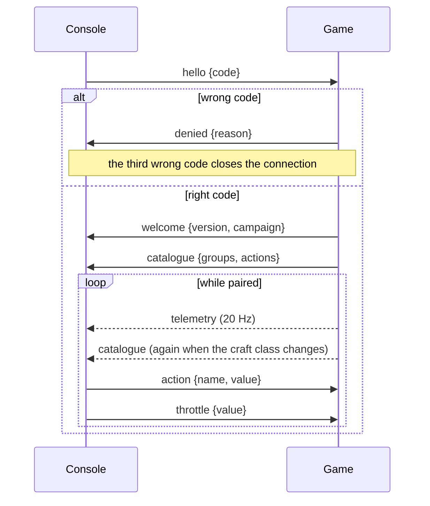

# Console protocol

**Status: version 1 implemented (C1, app 0.4.0); the rest planned.** The messages the game and a
control console exchange. The console is the tablet page served by the game
([F-CON-004](../definition/control-console.md#f-con-004-tablet-control-console)); later, a
physical panel over USB serial ([F-CON-007](../definition/control-console.md#f-con-007-physical-control-panel)).
Requirements: [R-CON-009 – R-CON-021](requirements/control-console.md). How it is built:
[Remote console](../implementation/architecture/remote.md).

Protocol **version 1** below is as built (`src/remote/protocol.rs`): `hello`, `welcome`,
`denied`, `catalogue`, `telemetry`, `action` and `throttle`. The messages marked *planned*
(`theme`, `contacts`, `model`, `event`) keep the names, directions and rates already decided;
their fields are fixed when interlude items C2–C4 build them, and this page is updated in the
same change.

## Transport

- Each message is one JSON object with a `type` field, sent as one WebSocket text frame.
- **WebSocket** (first transport, built): the game serves the console page (`/`,
  `/console.js`, `/console.css`, built into the program) and the socket (a WebSocket upgrade
  on any path; the page uses `/ws`) over HTTP/1.1 on port **8765** by default
  (`console.port` in `settings.yaml`, `--console-port`). The console is **off by default**
  (decision D2): `--console` or `console.enabled` turns it on.
- **Local network only**: connections from addresses that are not private, link-local,
  unique-local or loopback are dropped without an answer.
- **USB serial** (later, for an Arduino panel): the same messages, one per line. The protocol
  never depends on the transport.

## Session



Until a console has paired, every message other than `hello` is ignored, as is any message
that does not decode. When the connection closes, everything that console was holding is
released.

## Messages (version 1, as built)

### Console → game

| Message | Fields | Meaning |
|---|---|---|
| `hello` | `code`: string | The 6-digit pairing code the game shows. A right code pairs; a wrong one gets `denied`, and the third wrong code on a connection closes it. |
| `action` | `name`: string, `value`: number (default 1) | A catalogue action. For a `hold` action, `value` 1 presses and 0 releases it; for a `tap` action, a value above 0.5 fires it once. An unknown name is ignored. An action the craft cannot perform reaches the game like the bound key would, and does nothing. |
| `throttle` | `value`: number | The throttle position, clamped to 0 – 1, as if set from a slider. |
| `ping` | none | Heartbeat, every 250 ms. A console silent for 1 s (`HOLD_TIMEOUT`) has its held actions released, so a dropped connection never leaves a button pressed. |

```json
{"type": "hello", "code": "123456"}
{"type": "action", "name": "fire_beams", "value": 1}
{"type": "action", "name": "fire_beams", "value": 0}
{"type": "throttle", "value": 0.8}
```

### Game → console

| Message | When | Fields |
|---|---|---|
| `welcome` | Right code | `version` (1), `campaign` (the active campaign's id, empty if none). |
| `denied` | Wrong code | `reason` (`"wrong pairing code"`). |
| `catalogue` | After `welcome`; again whenever the player's craft class changes | `groups`: `[{id, title}]` in menu order (`flight`, `throttle`, `weapons`, `targeting`, `power`, `wingmen`, `views`, `camera`, `interface`). `actions`: `[{name, group, label, kind, available}]` for **every** action of the catalogue (R-CON-007): `name` as in `bindings.yaml`, `group` one of the ids above, `label` the display name, `kind` `"hold"` or `"tap"`, `available` false when the craft has no equipment for it (R-CON-019). |
| `telemetry` | **20 Hz** while paired | See below. |

**Availability.** An action is unavailable when the current craft lacks what it needs: `cloak`,
`ecm` and `tractor` need that system fitted; the four VCT slides need a class with `vct`;
missile firing and cycling need missiles aboard; beam firing, link cycling, beam charge and
power-to-beams need a class with beams. Every other action is always available. Unavailable
actions are still listed, so the console shows them disabled, never hidden.

**`telemetry` fields.** Fractions are 0 – 1; distances in metres, speeds in m/s.

| Field | Type | Meaning |
|---|---|---|
| `time` | number | Mission time, seconds. |
| `alive` | bool | False once the player's craft is gone; then no other field is sent. |
| `craft` | string | The craft class's name. |
| `velocity` | `[x, y, z]` | Velocity in the craft's body axes: x right, y up, **z forward** (so `z` is forward speed and `x`, `y` are the drift). |
| `throttle` | number | Throttle position, 0 – 1. |
| `hull`, `energy` | number | Fractions of the class's maximum. |
| `shields` | `[fore, aft]` | Shield fractions. |
| `power` | `[beam, shield, levels, used, budget]` | The power distribution, as on the HUD's power readout. |
| `link` | string | The beam link mode, lower case. |
| `afterburner`, `braking` | bool | Afterburner lit; brake held. |
| `missile` | `{name, count}` | The selected missile rack; absent when the craft carries none. |
| `systems` | `[{kind, health, destroyed, on}]` | Each fitted system: its kind (lower case), health fraction, destroyed, switched on. |
| `target` | object | Absent without a target. `name` (class name), `relation` (`friendly`, `hostile`, `neutral`), `protect` (the target is protected by the player's faction), `distance`, `closing` (closing speed, positive while the gap shrinks), `hull`, `shields [fore, aft]`, and `rotation [x, y, z, w]`: the target's orientation **in the player's body axes** (the conjugate of the player's rotation times the target's), for the target viewport (R-CON-015). |

```json
{"type": "telemetry", "time": 12.5, "alive": true, "craft": "…", "velocity": [20, 0, 100],
 "throttle": 0.6, "hull": 1, "energy": 0.8, "shields": [1, 0.7], "power": [2, 2, 4, 4, 6],
 "link": "…", "afterburner": false, "braking": false, "missile": {"name": "…", "count": 4},
 "systems": [{"kind": "cloak", "health": 1, "destroyed": false, "on": false}],
 "target": {"name": "…", "relation": "hostile", "protect": false, "distance": 1000,
            "closing": 35, "hull": 0.5, "shields": [0, 1], "rotation": [0, 0.707, 0, 0.707]}}
```

*Values in the examples are illustrative.*

## Messages still planned

| Message | Direction | When | Carries (*planned* fields) |
|---|---|---|---|
| `theme` | game → console | After `welcome`; again when the campaign or craft changes | The active pack's console theme (R-CON-020): colours, fonts, frames and images taken from the pack's own console assets — never original art (R-CON-021). Interlude item C2. |
| `contacts` | game → console | **5 Hz** | Radar contacts with position relative to the player, faction and kind; nav points (R-CON-014). Item C4. |
| `model` | game → console | Once per target class, when first targeted | The target's mesh, **decimated**, for the viewport (R-CON-015). The orientation already travels in `telemetry`. Item C3. |
| `event` | game → console | As it happens | Messages and events (system damaged, missile lock, shield down, mission result) (R-CON-014). |

## Open

- The pairing code's lifetime: in version 1 it is chosen when the game starts and lasts for the
  run. Whether it should change after a pairing, or time out, is open.
- A client name and protocol version in `hello` (version 1 sends neither); how a version
  mismatch is reported.
- A per-action description in `catalogue` (R-CON-007): version 1 sends the label only.
- Field lists of `theme`, `contacts`, `model` and `event`; the decimation budget for `model`,
  and whether textures are sent.
- Slider-valued actions other than the throttle (power levels), for the C2 layout.
- Line framing and the message subset for the serial transport.
- The theme's file format in a pack.

## Revision history

| Version | Date | Change |
|---|---|---|
| 1.0.0 | 2026-11-11 | Bootstrap (planned): transport, session, messages `hello`, `welcome`, `catalogue` (with per-action availability), `theme`, `telemetry`, `contacts`, `model`, `action`, `event` |
| 1.4.0 | 2026-11-11 | `ping` heartbeat and the 1 s hold timeout (app 0.4.3) |
| 1.3.0 | 2026-11-11 | Version 1 as built (C1, app 0.4.0): `hello {code}`, `welcome {version, campaign}`, `denied {reason}`, `catalogue {groups, actions:[{name, group, label, kind, available}]}` with the availability rules, the `telemetry` fields (body-axis velocity, power, systems, target with relative rotation), `action {name, value}` hold and tap semantics and the new `throttle {value}`; the local-network rule and the three-wrong-codes limit. `theme`, `contacts`, `model`, `event` remain planned; open items revised |
