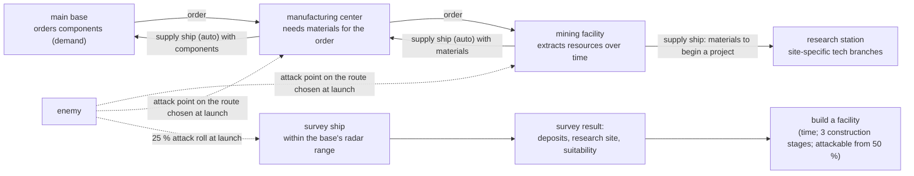

# Logistics: resources, facilities and supply lines

**Status: planned (design); decisions recorded 2026-11-11, revised the same day (survey and supply separated, supply convoys, construction thresholds).** Requirements: [Strategy & logistics](../requirements/strategy-logistics.md) (R-STR-012 – R-STR-027). A strategy-layer capability for the
**default campaign** (*Perils of the Void*). The `interceptor` campaign will **not** use it: it
stays a faithful match of the original (outposts, OPPs and freighter deliveries,
[Economy](format-strategy.md#economy)); an optional addon could add logistics to it. Everything
below is data in YAML rules a modder can change or leave out — every number is campaign-tunable,
and a campaign without `facility_types`, `recipes` and `logistics` sections behaves as today.
Owners: [Stage 4](../../implementation/plan/stage-4-strategy.md) (economy, facilities, logistics,
convoys, surveys), [Stage 3](../../implementation/plan/stage-3-missions.md) (the two new mission
types) and [Stage 5](../../implementation/plan/stage-5-campaign.md) (the rival's depots, third-party
convoys).

**Already in the engine (Stage 2):** the facility and supply-craft objects of the default
campaign (`rules/logistics.yaml`: mining facility, research station, manufacturing center with
turret and shield slots; the cargo clipper and cargo pod), their three construction stages with
their own meshes and debris, and the `construction-defence` and `convoy-ambush` testbed arenas
([Testbed](../../implementation/architecture/testbed.md)). The strategy-layer simulation below is Stage 4.

!!! note "As built (app 0.9.0, main `ff9d8fc`)"
    The core of this design is built — resources, components, recipes, the three facility types,
    research sites and station-only topics, deposits and features on the map, surveys within
    radar range with the attack roll at launch, demand-driven orders, automatic convoys of several
    vessels along the lanes with the ambush point rolled at launch, and saves — with the keys on
    [Strategy layer › Logistics](../../modding/strategy.md#logistics) and the runtime on
    [Campaign › Logistics](../../implementation/architecture/campaign.md#logistics). Differences
    from this design: placement is **fixed rules per role** instead of `placement:` expressions,
    and the nearest supplier is measured in a straight line (DEV-049); ambushes and attacks on
    survey ships are **auto-resolved**. Not built yet: flying `convoy_ambush`, construction stages
    on the map and construction strikes, facility fighter pools and escorts, captured cargo and
    enemy depots, third-party convoys, cargo capacity and facility upgrades. Requirement statuses:
    R-STR-012 – R-STR-027.

!!! note "As built (app 0.9.2, main `0d1c522`, `146195b`): flown ambushes and the supply vessel"
    With `logistics.ambush_mission` an ambushed convoy waits for the player, who flies its escort
    (`convoy_ambush`) or lets it fight through; a flown escort delivers the share of cargo still
    aboard. The supply vessel is the cargo clipper with twelve cargo pods and a point-defence
    laser as modules; grappler tugs with saucer escorts tear pods off and capture them. Captured
    cargo is lost to the player but not yet stored at an enemy depot (5.11).

## What the player does



1. **Survey.** A base launches a **survey ship** to a system **within its current radar range**;
   the survey ship reports the system's deposits and whether it suits a mining facility, a research
   station or a manufacturing center. When a survey ship launches, a **25 % roll** decides
   whether it will be attacked. Survey ships and supply ships are **different mission profiles
   and different craft**.
2. **Build.** A facility is built in a system that meets its type's requirements. Building takes
   time and passes through **three construction stages**; from **50 %** the enemy may try to
   destroy it (a construction-defence mission), at most **three times** per location.
3. **Demand pulls supply.** The main base **orders** components (for fighters and other
   technology) from a manufacturing center. An order needs materials; the center **orders**
   them from mining facilities. A part cannot be produced until enough materials are in the
   center's store. This is the familiar "bases produce fighters and parts" model with a supply
   chain behind it: a basic supply-and-demand simulation in which demand creates orders and
   orders pull materials along the chain.
4. **Ship.** When a delivery is ready, a **supply convoy** is dispatched **automatically** along
   the fixed lanes: several large supply vessels, each carrying an **even share** of the cargo.
   Supply ships are provided by the government — the player does not buy or manage them. The
   position along the route where the convoy will be attacked is **chosen at random at launch**.
   A destroyed or captured vessel's share never arrives; the surviving vessels deliver theirs.
5. **Research.** Research stations unlock tech branches that ordinary bases cannot research, only
   in systems meeting their site criteria. Resources are needed **only to begin** a project;
   research then continues without further supply.
6. **Defend.** Fighters are built at main bases and then **transferred** to facilities, where they
   form a separate pool from base hangars; they defend the facility's system and escort its supply
   ships, and can be moved between facilities.

## Data model

All sections live in the campaign's `strategy/*.yaml` (the strategy-layer files of
[Format: strategy layer](format-strategy.md)). Quantities use the implemented units (`48h`,
`2.4km`, `40%`); conditions and expressions use the [condition language](format-behaviour.md#conditions)
with a **campaign context** (planned, Stage 3–4).

### Resources and deposits

The set of resources is **campaign data**: whatever the campaign's tech tree and core
construction need. The names below are examples of the form.

```yaml
resources:
  iron:      {name: "@res.iron", unit: t, bulk: 1}          # bulk: cargo space per unit
  gold:      {name: "@res.gold", unit: t, bulk: 1}
  dilithium: {name: "@res.dilithium", unit: kg, bulk: 0.1, rare: true}
  cosmium:   {name: "@res.cosmium", unit: t, bulk: 1}       # the default campaign's signature resource

maps:
  reach:
    systems:
      ajax:
        pos: [4300, 1500]
        class: red_dwarf
        bodies: [planet:ice, belt:rich]
        deposits:                           # what can be mined, where, how fast, how much
          cosmium: {body: belt, rate: 6/day, reserve: 1800}
          iron:    {body: planet, rate: 20/day, reserve: unlimited}
        features: [nebula, pulsar_near]     # tags for research-site criteria
        hidden_deposits: true               # only a survey reveals them
```

- **Deposits** belong to a system (optionally a body). `rate` is the base extraction rate of a
  level-1 mining facility; `reserve` runs down as it is mined (`unlimited` allowed).
- **Features** are free tags a campaign defines (`nebula`, `pulsar_near`, `derelict`);
  research-site criteria test them.

### Components and recipes

What is manufactured is campaign data too — generally the **components** fighters and other
technology are built from:

```yaml
components:
  hull_plating:  {name: "@comp.hull_plating"}
  ray_emitter:   {name: "@comp.ray_emitter"}
  rocket_motor:  {name: "@comp.rocket_motor"}

recipes:
  hull_plating:
    at: manufacturing_center
    inputs: {iron: 20t, cosmium: 2t}
    time: 24h
    output: {component: hull_plating, amount: 4}
  ray_emitter:
    at: manufacturing_center
    inputs: {gold: 2t, dilithium: 5kg}
    time: 48h
    output: {component: ray_emitter, amount: 1}
    requires: "research(heat_ray)"

hulls:
  comet:
    build_at: main_base                      # fighters are built at main bases …
    components: {hull_plating: 8, rocket_motor: 2, ray_emitter: 2}   # … from delivered components
    time: 120h
```

A manufacturing center runs up to `lines` recipes at once; a recipe **starts only when its inputs
are in that center's store**, takes `time`, and its output waits in the store for shipment. A
main base builds hulls and items from components in its own store.

### Facility types

```yaml
facility_types:
  mining_facility:
    name: "@fac.mining"
    hub: objects.mining_facility             # implemented object with construction stages
    role: mining
    placement: "survey_known(system) and deposit(system, any) > 0"
    max_per_system: 1
    build: {cost: 400000, time: 240h, stages: [build_25, build_60, build_90]}
    extracts: {rate: "deposit_rate(system, resource) * level", storage: 400t}
    upgrades: {level_2: {cost: 250000, time: 120h, requires: "research(deep_drills)"}}

  research_station:
    name: "@fac.research"
    hub: objects.research_station
    role: research
    placement: "survey_known(system) and research_site(system, any)"
    build: {cost: 900000, time: 480h, stages: [build_25, build_60, build_90]}
    research_rate: 40                        # work units per hour

  manufacturing_center:
    name: "@fac.manufacturing"
    hub: objects.manufacturing_center
    role: manufacturing
    placement: "owned(system) and lane_distance(system, nearest_base) <= 2"
    build: {cost: 1200000, time: 360h, stages: [build_25, build_60, build_90]}
    lines: 2                                 # recipes running at once
    storage: 800t

fighter_pools:                               # fighters assigned to facilities (separate from base hangars)
  per_facility: {mining: 2, research: 2, manufacturing: 4}
  transfer_time: lane                        # moved between facilities along the lanes
```

| Key | Meaning |
|---|---|
| `role` | `mining`, `research` or `manufacturing` (engine behaviours); ordinary `base_types` keep theirs. |
| `hub` | The object class placed on the map and in battles at this facility — its model set has the construction stages. |
| `placement` | A campaign condition over the candidate system (`deposit(...)`, `research_site(...)`, `owned(...)`, `lane_distance(...)`, `survey_known(...)`). |
| `build` | `cost`, `time`, `stages` (three state names of the hub's model set, in order), `requires` (research). |
| `extracts`, `lines`, `research_rate`, `storage` | Role parameters. |
| `upgrades` | Levels with cost, time and requirements. |

### Research sites and tech branches

```yaml
research_sites:
  nebula_lab:
    name: "@site.nebula_lab"
    criteria: "feature(system, nebula) and star_class(system) in [red_dwarf, blue_giant]"
  pulsar_array:
    criteria: "feature(system, pulsar_near)"

research:
  theremin_shielding:
    size: 24000
    requires: "research(force_fields)"
    lab: research_station                    # only research stations can work on it
    site: nebula_lab                         # …and only one at a nebula lab site
    start_cost: {cosmium: 20t, dilithium: 2kg}   # delivered once; the project then runs unsupplied
```

`lab:` restricts a topic (or a whole branch, `branches: {theremin: {lab: research_station}}`) to
a facility type; `site:` further to stations in systems meeting a research site's criteria.
`start_cost` is the materials a station needs **to begin** the project — they are ordered from
mining facilities like any other demand; once delivered, research runs to completion with no
further supply. Topics without `lab:` are researched as today (the campaign's `research_model`).

### Orders, supply ships and ambushes

```yaml
logistics:
  travel: lanes                              # fixed lanes only
  orders:                                    # demand creates orders; orders pull materials up the chain
    main_base:      {from: manufacturing, wants: components}    # for hulls and items in its build queue
    manufacturing:  {from: mining, wants: recipe_inputs}        # for the recipes it must run
    research:       {from: mining, wants: start_cost}           # once, to begin a project
  source: nearest_by_lane                    # which facility fills an order
  dispatch: "order_filled"                   # a supply ship leaves when the order's cargo is ready
  supply_ship:
    object: objects.supply_ship              # implemented: the cargo clipper; a larger convoy vessel is planned
    provided_by: government                  # automatic; not bought or managed by the player
    convoy: {vessels: tbd, cargo: even_share}   # several vessels; each carries an even share
    capacity: tbd                            # TBD: per vessel, set with the tech-tree balance
    escort: {from_facility_pool: true, max: 3}
  ambush:
    position: random_on_route                # where along its route the convoy is attacked, chosen at launch
    attackers: "strategist_force(lane_threat)"
  losses:
    destroyed: lose_cargo
    captured: {cargo: captor, store_at: nearest_supply_depot}   # the enemy stores it
```

- **Demand-driven.** Nothing is shipped speculatively. A main base's build queue creates orders
  for components; a manufacturing center's recipes create orders for materials; a research
  station's `start_cost` creates a one-off order. Each order is filled by the nearest suitable
  facility; when its cargo is ready, a supply ship leaves.
- **Supply ships** are automatic and provided by the government: the player never buys or
  manages them, but may escort them with the facility's assigned fighters.
- **Supply convoys.** A shipment travels as a convoy of several vessels, each carrying an even
  share of the cargo, so a partly destroyed convoy delivers the surviving share. Single ships
  would be destroyed quickly; convoys keep escort missions interesting and playable. A supply
  vessel is reasonably large: a core vessel with several attached cargo containers (a new
  default-campaign model, planned).
- **Attack position at launch.** When a convoy launches, the point along its route where it will
  be attacked is chosen at random; when the convoy reaches it, a `convoy_ambush` mission is
  generated (the player may fly it; otherwise it is auto-resolved). *Open: whether every supply
  convoy is attacked, or only some and at what chance — the user's answer gives the 25 % roll
  for survey ships only.*
- **Losses.** A destroyed vessel's cargo is lost. A **captured** ship's cargo goes to the enemy,
  who stores it at a **supply depot**; destroying an enemy supply depot lets the player
  **seize** the resources stored there.

```yaml
objects:
  dominion_supply_depot:                     # the rival's store of captured and mined cargo
    kind: station
    depot: {seize_on_destroyed: true}        # the player takes its stock when it falls
```

### Mission types tied to logistics (Stage 3)

```yaml
missions:
  convoy_ambush:                             # the marked supply ship reaches its ambush point
    location: lane
    generated: "supply_ship_ambush_point_reached"
    roles:
      convoy: {from: supply_ships, behaviour: freighter_run, protect: true}
      escorts: {from: supply_ship_escorts}
      attackers: {from: ambush_force}
      player: {from: launched_craft, optional: true}
    arrivals: {attackers: {distance: 5km, from_role: convoy, ambush: true}}
    objectives:
      win: "destroyed_all(attackers) or retreated_all(attackers) or departed_all(convoy)"
      lose: "destroyed_all(convoy) or captured_any(convoy)"
    outcomes:
      win: [deliver(convoy)]
      lose: [lose_cargo(convoy)]             # or captor stores it (losses.captured)
    auto_resolve: true

  construction_defence:                      # the enemy strikes a facility before it is finished
    location: facility
    generated: "facility_progress(site) >= 50% and construction_attacks(site) < 3 and hostile_targets(site)"
    roles:
      site: {from: target_facility, state: build_stage}   # shown in its construction-stage state
      guards: {from: facility_pool}
      attackers: {from: attacking_squadron}
      player: {from: launched_craft}
    objectives:
      win: "destroyed_all(attackers) or retreated_all(attackers)"
      lose: "destroyed(site)"
    outcomes:
      lose: [lose_facility(site)]
```

- Construction attacks become possible once a facility reaches **50 %** and happen **at most
  three times** per location (`construction_attacks`); both numbers are campaign data.
- `state: build_stage` uses the implemented scenario `state:` (an object shown in a state has no
  modules or point defence yet), and `protect: true` the implemented objective marking.
- The default campaign's **Escort** and **Convoy raid** mission types become these generated
  missions on the strategy map; the testbed already has both arenas.

### Survey ships

Surveys are flown by **survey ships**: a mission profile and a craft distinct from supply ships.

```yaml
survey_ships:
  survey_ship:
    object: objects.sky_eye_probe            # the battle object used so far (implemented); see Open questions
    launch_from: base
    range: radar                             # systems within the launching station's current radar range
    survey_time: 24h
    attack: {chance: 25%}                    # rolled once, when the survey ship launches
    reveals: [deposits, features, research_sites, suitability]
```

When a survey ship launches, a 25 % roll decides whether it will be attacked. A survey records, per system: deposits and reserves, features, the research sites it qualifies
for, and for each facility type whether `placement` holds — the **suitability** shown on the
star map.

### Third-party convoys

Prospectors and the Cartel run convoys with the same entities, with their own movement rules:

```yaml
third_party_convoys:
  prospectors:
    pattern: expedition                      # base → system under investigation → pause → base
    targets: "unsurveyed_or_rich(system)"
    stay: [48h, 120h]                        # prospecting (in-universe: then home to restock)
  cartel:
    pattern: random                          # random destinations, including empty or uncharted stars
    destinations: any_star
```

Escorting or attacking them changes relations (the campaign's dynamic relations).

## Construction stages as model-set states

Each facility hub's model set has **three** states, one per construction stage, each swapping
the **mesh** and naming its **own debris** (both implemented in Stage 2):

```yaml
modelsets:
  mining_facility:
    intact: models/mining_facility.obj
    states:
      build_25: {model: models/mining_facility_build1.obj, debris: mining_facility_build1}
      build_60: {model: models/mining_facility_build2.obj, debris: mining_facility_build2}
      build_90: {model: models/mining_facility_build3.obj, debris: mining_facility_build3}
```

The strategy layer shows `build_25` from the start of construction (0 %), `build_60` from 60 %
and `build_90` from 90 %, and the intact model on completion. These thresholds — **0 / 60 / 90 %**
— are confirmed by the user (2026-11-11); the stage list in `build.stages` is the data. The same state is used on
the strategy map's 3D view and in battle. The generator (`tools/default_assets/`) builds the
stage models — scaffold, frame, cladding — for the three facilities and the Guard station.

## Engine pieces

| Piece | Stage | What it does |
|---|---|---|
| Campaign context for conditions | 3–4 | System and facility queries (`deposit`, `feature`, `research_site`, `survey_known`, `owned`, `lane_distance`, `facility_progress`, `construction_attacks`) for `placement`, `criteria`, `generated`. |
| **Economy tick** (`campaign::economy`) | 4 | On the campaign clock: extraction, recipe progress, research, construction progress and stage changes; storage limits stop production when full. Deterministic; unit-tested on synthetic campaigns. |
| **Order book** (`campaign::logistics`) | 4 | Demand → orders → sources along the chain (main base ← manufacturing ← mining; research ← mining once per project); the logistics graph over the fixed lanes for nearest sources and paths. |
| **Supply convoys** (`campaign::convoys`) | 4 | Spawned automatically when an order is filled, as several vessels sharing the cargo evenly; move along lanes; the attack point chosen at launch; delivery of the surviving share or loss; captured cargo to the captor's depot. Shared with the rival's plan shipments and third-party convoys. |
| **Mission generation hooks** | 3–4 | `convoy_ambush` at the ambush point; `construction_defence` from 50 % (at most three per location); auto-resolve when the player does not fly. |
| Surveys | 4 | Survey-ship launch within radar range, the 25 % attack roll, survey timer, results per system. |
| Research labs, sites and start costs | 4 | `lab:`, `site:`, `start_cost` in the research model. |
| Facility fighter pools | 4 | Fighters built at main bases, transferred to facilities, moved between them. |
| Supply depots | 5 | The rival stores captured and mined cargo; the player seizes a destroyed depot's stock. |
| Construction states | 2 (done) → 4 | Mesh-swapping states with their own debris (implemented); the strategy layer selects the stage. |
| Screens | 4 (functional) → 6 (skinned) | Facility screen (orders, store, queue, assigned fighters), survey overlay, supply traffic on the star map. |
| Saves | 4 | Stores, orders, build progress, convoys and survey ships in flight with their attack rolls and points, survey results. |

## Decisions (2026-11-11)

| Question | Decision |
|---|---|
| Supply ships | Automatic, provided by the government; not purchased or managed. |
| Travel and routing | Fixed lanes. Destinations follow each facility's requirements: demand creates orders that pull materials along the chain (main base ← manufacturing ← mining). |
| Resources | Campaign data, set by what the tech tree and core construction need (e.g. iron, gold, dilithium); manufacturing produces components for fighters and other technology. |
| Research stations | Resources are needed only to **begin** a project. |
| Survey and supply | Different mission profiles and different craft (revised 2026-11-11; the earlier reading "survey ship = supply ship" is withdrawn). |
| Survey range | Systems within the launching station's current radar range. |
| Attacks | The 25 % attack roll is made when a **survey ship** launches; a **supply ship's** attack position along its route is chosen at random at launch. User's words: "25% probability, determined at survey ship launch. attack position on supply ship along route randomly determined at launch as well". |
| Supply convoys | Several vessels, each with an even share of the cargo; a partly destroyed convoy delivers the surviving share. Reason: escort missions stay interesting and playable, since single ships would be destroyed quickly. A supply vessel is a core vessel with several attached cargo containers (new default-campaign model, planned). |
| Captured cargo | Feeds the enemy, stored at supply depots; destroying a depot lets the player seize its stock. |
| Construction attacks | Possible from 50 % construction; at most three per location. |
| Facility fighters | A separate pool from base hangars; built at main bases, then transferred; movable between facilities. |
| Third parties | Prospector convoys: base → system under investigation → pause → base. Cartel convoys: random destinations, including empty or uncharted stars. |
| `interceptor` | No logistics: it stays a faithful match of the original; an optional addon could add it. |
| Construction stages | Three, each with its own mesh and debris (implemented); shown from 0 %, 60 % and 90 % (confirmed). |

## Open questions

1. **Cargo capacity** of a supply vessel — still TBD, set by the tech-tree balance (`capacity: tbd`).
2. **Supply-convoy attacks** — whether every convoy is attacked at its chosen point, or only some
   and at what chance.
3. **Survey ship** — its craft (the Sky-Eye probe object or a new model), and where, when and in
   which mission an attacked survey ship meets its attackers.
4. **Convoy size** — the number of vessels per supply convoy.

## Revision history

| Version | Date | Change |
|---|---|---|
| 1.0.0 | 2026-11-11 | Adopted into Specification 1.0.0. Decisions revised: survey and supply ships are different profiles and craft (the "survey ship = supply ship" interpretation removed); the 25 % attack roll at survey-ship launch; supply-ship attack position chosen at launch; supply convoys with even cargo shares and a larger convoy vessel; construction thresholds 0 / 60 / 90 % confirmed; cargo capacity still TBD |
| 1.14.0 | 2026-11-11 | As-built note (app 0.9.0): what is built, the two differences (fixed placement rules, straight-line nearest supplier; DEV-049), auto-resolved ambushes and survey attacks, and what is not built yet |
| 1.15.0 | 2026-11-11 | As-built note (app 0.9.2): flown convoy ambushes (`ambush_mission`), the supply vessel with cargo pods and a point-defence laser, tugs and escorts; depots still not built |
